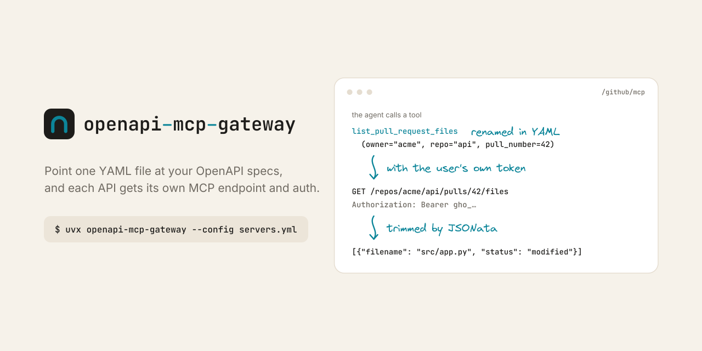

<p align="center">
  <a href="https://github.com/mroops0111/openapi-mcp-gateway/actions/workflows/ci.yml"></a>
  <a href="https://pypi.org/project/openapi-mcp-gateway/"></a>
  <a href="https://pepy.tech/projects/openapi-mcp-gateway"></a>
  <a href="https://pypi.org/project/openapi-mcp-gateway/"></a>
  <a href="LICENSE"></a>
</p>

Mount any OpenAPI (Swagger) spec as a [Model Context Protocol (MCP)](https://modelcontextprotocol.io/) server from one YAML file, with no code to write. Per-user OAuth and per-operation scopes give fine-grained access control, and tool shaping and dynamic exposure give context efficiency on large APIs. One process runs several APIs, each with its own endpoint and auth.

With [uv](https://docs.astral.sh/uv/getting-started/installation/) installed, one command serves the Petstore API:

```bash
uvx openapi-mcp-gateway serve --spec https://petstore3.swagger.io/api/v3/openapi.json --name petstore
```

Then connect any MCP client, such as Claude Code, Cursor or VS Code, to `http://127.0.0.1:8000/petstore/mcp`. [Read the documentation](https://mroops0111.github.io/openapi-mcp-gateway/), or start with [Getting Started](https://mroops0111.github.io/openapi-mcp-gateway/getting-started/).

## Highlights

Five things set it apart from a server generated once from a spec.

- **Many APIs, One File**: one YAML file mounts several OpenAPI specs side by side, each at its own endpoint with its own auth, with no code to write.
- **Fine-Grained Access Control**: the gateway signs users in itself or trusts your identity provider, then grants scopes per operation, so each client reaches only the tools its task needs.
- **Tool Shaping**: rename operations, hide or pin parameters, and rewrite requests and responses with JSONata, without forking the spec.
- **Large APIs**: a spec with 1,000+ operations goes behind three search tools, and read-only GETs can become resources, so the model's context stays small.
- **Spec-Compliant Security**: the gateway follows the MCP authorization rules, accepts only tokens minted for each endpoint, and reaches the API with a credential of its own rather than the client's token.

## Architecture

Each tool call is authorized, shaped and sent upstream, and its response is reshaped on the way back.

![openapi-mcp-gateway architecture. An MCP client calls an MCP endpoint, one per API, which config.yml builds at startup. Each call is authorized first, by its token and then by the scopes the operation needs, getting an upstream token from the API's authorization server or your identity provider when the mode calls for one. The request is shaped by params and JSONata and sent with the upstream credential, over HTTP to a REST API or over ASGI to a FastAPI app in the same process. The response comes back reshaped by JSONata.](docs/assets/architecture-light.svg#gh-light-mode-only) 

## Documentation

The full documentation lives at [mroops0111.github.io/openapi-mcp-gateway](https://mroops0111.github.io/openapi-mcp-gateway/).

- [Getting Started](https://mroops0111.github.io/openapi-mcp-gateway/getting-started/) covers installation, a connected client and a config file
- [Guides](https://mroops0111.github.io/openapi-mcp-gateway/guides/authoring-with-ai/) covers AI authoring, exposure, tool shaping, authorization, scopes, identity providers, deployment and Python
- [Concepts](https://mroops0111.github.io/openapi-mcp-gateway/concepts/architecture/) covers the request path, security, context efficiency, the scope model, token lifecycles and dynamic exposure
- [Reference](https://mroops0111.github.io/openapi-mcp-gateway/reference/configuration/) lists every config field and CLI flag
- [Evaluation](https://mroops0111.github.io/openapi-mcp-gateway/evaluation/) shows how the gateway is measured and what it gains

## License

[MIT](LICENSE)
