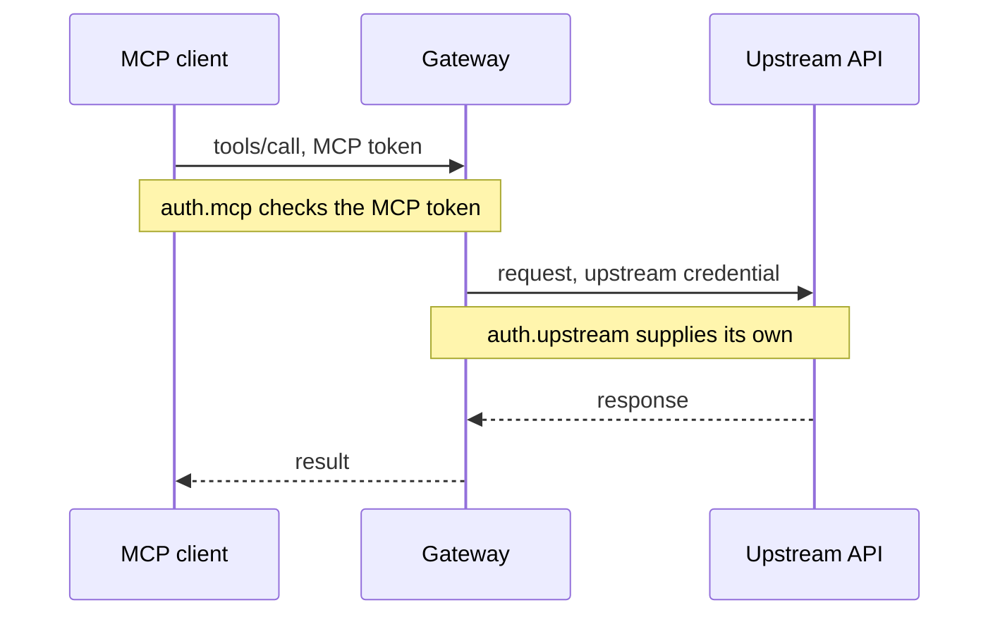

# Architecture

This page describes the path of one tool call through the gateway, the two authorization boundaries every call crosses, and what a client gets back.

## Request Path

Each tool call is authorized, by its token and then by its scopes, shaped, and sent upstream in turn, and its response is reshaped on the way back.

![openapi-mcp-gateway architecture. An MCP client calls an MCP endpoint, one per API, which config.yml builds at startup. Each call is authorized first, by its token and then by the scopes the operation needs, getting an upstream token from the API's authorization server or your identity provider when the mode calls for one. The request is shaped by params and JSONata and sent with the upstream credential, over HTTP to a REST API or over ASGI to a FastAPI app in the same process. The response comes back reshaped by JSONata.](../assets/architecture-light.svg#only-light) 

- **Authorize**: the endpoint verifies the caller's token, unless the mode leaves it open. Where `auth.mcp.operation_scopes` is set, a call short of the MCP scopes its operation needs is then refused, with a `403` it can step up from when the client is on protocol version 2026-07-28. Under `enforce_scopes`, a call is also checked against the user's upstream grant. [Scope Model](scope-model.md) covers both checks.
- **Shape**: parameters and JSONata transforms turn the tool call into the upstream request. Under dynamic exposure the call arrives through `call_operation`, as [Dynamic Exposure](dynamic-exposure.md) describes. [Context Efficiency](context-efficiency.md) compares the ways exposure and shaping keep the model's context small.
- **Call**: the request goes upstream with the mode's credential. Under `authorization_code`, a refused upstream token is renewed or the user is asked to sign in again, as [Token Lifecycle](token-lifecycle.md#upstream-token-refusals) describes.

## Two Authorization Boundaries

Every request crosses two boundaries, and one `auth:` block configures both. `auth.mcp` decides who may call the MCP endpoint, and `auth.upstream` decides what credential reaches the API behind it.

[Authorization](../guides/authorization.md#mode-selection) lists the pairings the gateway supports.

## Token Forwarding Policy

The MCP spec requires a server to accept only tokens minted for itself, and forbids relaying one to an upstream API. So every mode except `passthrough` reaches the upstream with a credential other than the one the caller presented, either a shared one or a per-user one the gateway obtained separately. See [Access Token Privilege Restriction](https://modelcontextprotocol.io/specification/2026-07-28/basic/authorization/security-considerations#access-token-privilege-restriction).

`passthrough` is the one exception, and it exists for the [FastAPI integration](../guides/python.md#fastapi-integration), where the gateway runs in-process as part of the app it exposes and shares its OAuth audience, so no separate upstream exists and no third party receives the token. Setting it against a separate API is the confused-deputy pattern the spec forbids, so nothing selects `passthrough` automatically outside the FastAPI integration. [Security](security.md) lists the other safeguards the gateway applies, and [Token Audience](token-lifecycle.md#token-audience) how a token stays at the endpoint it was minted for.

## Tool Results

Every registered tool carries a protocol-native `title` and `annotations` (`readOnlyHint`, `destructiveHint`, `idempotentHint`), so the model can judge a tool before calling it. Results carry `structuredContent`, so a client reads a typed body and structured error payloads without re-parsing text. A binary response, such as an image or a PDF, arrives as a content block rather than decoded text. None of this needs configuration.

## Related

These pages configure each boundary on the request path and the tools a client gets back.

- **Guides**: [Authorization](../guides/authorization.md#mode-selection) for pairing an upstream credential with MCP auth and [Tool Shaping](../guides/tool-shaping.md) for changing what a tool takes and returns
- **Reference**: [`auth.upstream`](../reference/configuration.md#authupstream) for the upstream boundary's fields and [`auth.mcp`](../reference/configuration.md#authmcp) for the MCP boundary's fields
