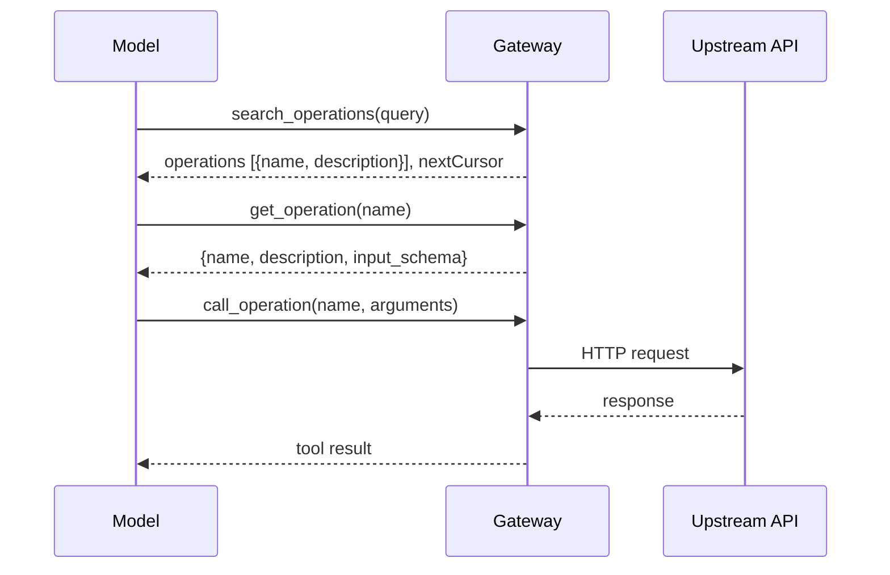

# Dynamic Exposure

This page explains the three meta-tools, which search, describe and call operations, that a server under `exposure.style: dynamic` exposes in place of its operations, what each returns, and how search ranks operations. [Context Efficiency](context-efficiency.md) covers why a large API needs them.

## The Three Meta-Tools

The model goes from a request in words to an upstream call in three steps:

| Tool | Arguments | Returns |
|---|---|---|
| `search_operations` | `query`, `tags`, `cursor`, all optional | `{operations: [{name, description}], nextCursor}`, best match first, 20 per page |
| `get_operation` | `name` | `{name, description, input_schema}` |
| `call_operation` | `name`, `arguments` | The operation's result, as a static tool would return it |

`search_operations` follows these rules.

- **Query**: a string, or a list of up to 10 phrasings. Each phrasing is ranked on its own, and the rankings are merged.
- **Tags**: keeps operations carrying any of the given tags, compared without case.
- **No Filter**: an omitted argument filters nothing. With neither `query` nor `tags`, the first page also carries `tags: [{name, operations}]`, each tag with its operation count.
- **Paging**: `nextCursor` appears when more matches exist. Pass it back as `cursor`.
- **Descriptions**: cut to 200 characters. `get_operation` returns the full text.

Auth, path templating and shaping work as under static exposure, so only how operations surface changes. Under [operation scopes](scope-model.md#visibility), search and get show only the operations the caller's token can use or step up to.

## Search Ranking

By default `search_operations` ranks with BM25F, a standard keyword ranking that scores each field of an operation separately and then weighs the fields. A word counts more when few operations contain it. Words match across camelCase, snake_case and paths, and across forms such as `branch` and `branches`. Synonyms do not match, so `close an issue` misses an operation described only as "update an issue".

| Field | Default Weight |
| --- | --- |
| `summary` | `3` |
| `name` | `2` |
| `description` | `0.5` |
| `path` | `0.5` |
| `tags` | `0.5` |
| `parameters`, each argument's name and description | `0` |

A weight multiplies how much a matching word counts in that field. `1` is an ordinary match, and the weights need not add up to anything. [Tuning Search Weights](../guides/exposure.md#tuning-search-weights) shows how to override them per server.

## Semantic Search

Words alone miss a request phrased differently from the spec, as the [search ranking benchmark](../evaluation.md#search-ranking) shows. `exposure.search.semantic` ranks by meaning instead, through an embedding model, which turns text into a vector so that texts with similar meaning sit close together.

- **First Search**: every operation is embedded. With `cache_directory` set, the vectors are kept on disk, so a restart embeds only operations whose text changed.
- **Retrieval**: `retrieval: semantic` ranks by the embedding alone, and `retrieval: hybrid` merges the embedding's ranking with the word ranking.
- **Fallback**: when the model fails, or embedding a query takes over 10 seconds, that search ranks by words alone and the gateway skips the model for a minute.

[Searching by Meaning](../guides/exposure.md#searching-by-meaning) covers the setup.

## Related

The exposure guide covers turning on dynamic exposure and tuning its search, and the reference lists its fields.

- **Guides**: [Exposure](../guides/exposure.md#dynamic-exposure) for setting `exposure.style: dynamic` on a server
- **Reference**: [`exposure`](../reference/configuration.md#exposure) for the style, search weight and semantic search fields
