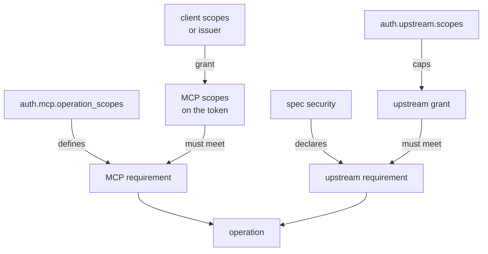
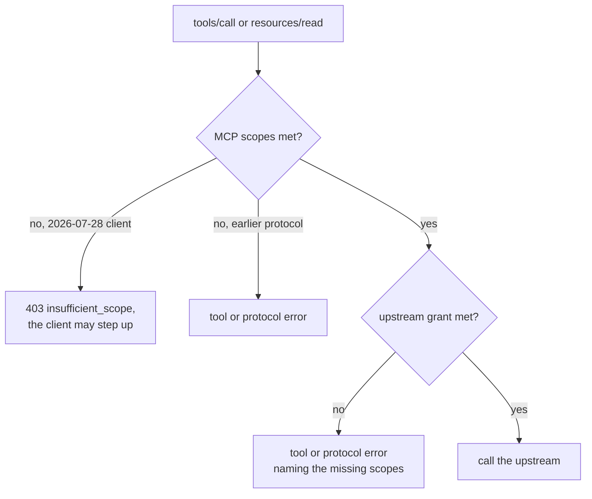
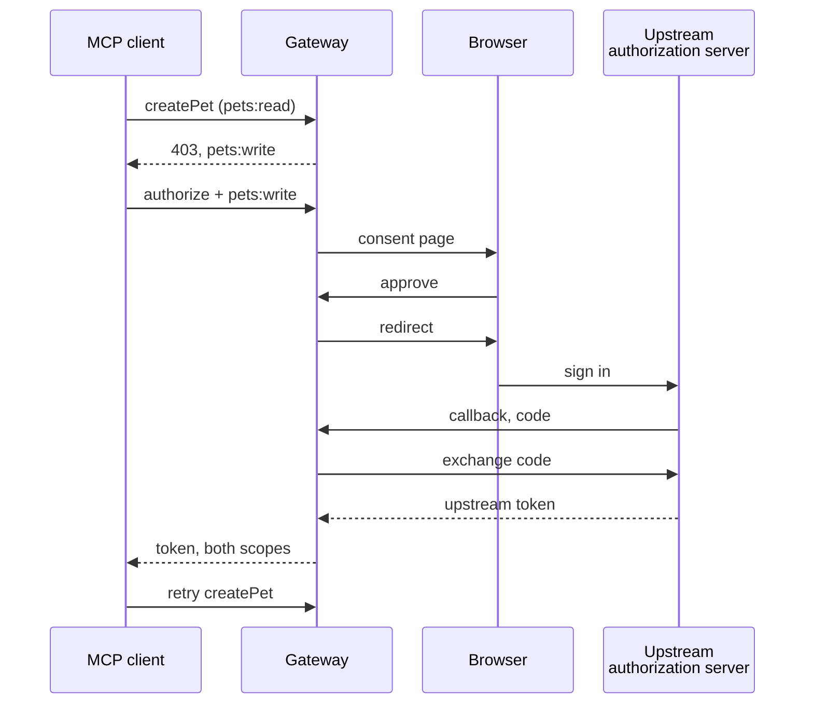

# Scope Model

This page explains how the gateway decides what an MCP token may list and call, and what a sign-in asks the upstream for. [Scopes](../guides/scopes.md) covers the setup.

## Two Kinds of Scope

Every operation carries two requirements, one per kind of scope, and a call must meet both.

| Kind | Defined By | Granted By |
| --- | --- | --- |
| MCP Scope | `auth.mcp.operation_scopes` | the gateway per client, or an external issuer |
| Upstream Scope | the operation's OpenAPI `security`, or `operations.<id>.security` | the upstream authorization server, recorded per user |

MCP scopes are the gateway's own vocabulary, so they can tell apart clients that share one upstream identity. Upstream scopes are what the upstream token holds, so they keep a user's sign-in no wider than the operations it opens.



## Mechanisms by Mode

Each mechanism needs something only some modes have. The upstream checks need each user's own upstream grant, which only `authorization_code` and `token_exchange` know. The open modes, `passthrough` among them, check no token, so they take no scopes.

| Mechanism | `authorization_code` | Shared Credential With `auth.mcp.clients` | Shared Credential With `auth.mcp.issuer` | `token_exchange` |
| --- | --- | --- | --- | --- |
| Operation Scopes | yes | yes | yes | yes |
| Client Scopes | yes | yes | the issuer decides | the issuer decides |
| Upstream Grant Check | with `enforce_scopes` | no per-user grant | no per-user grant | with `enforce_scopes`, from each exchange |
| Step-Up | a new sign-in | a new token request | at the issuer | at the issuer |
| Downscoping | with `enforce_scopes` | no sign-in | no sign-in | with `enforce_scopes`, at each exchange |

Under `authorization_code` the upstream grant is recorded on the MCP token at sign-in. Under `token_exchange` each exchange returns it, or the requested scopes when the response omits them.

Step-up asks for more scopes when a call needs them, and downscoping asks the upstream for only the scopes the MCP grant opens, as [Step-Up](#step-up) and [Downscoping](#downscoping) explain.

## Permission Check

A call checks the MCP scopes first, then the upstream grant. Only the MCP side can be stepped up for, so it is refused first.



- **Challenge**: a client on MCP protocol version 2026-07-28 sends `Mcp-Method` and `Mcp-Name` headers that name the tool or resource it calls. The gateway reads them before the call reaches MCP and answers with an HTTP `403` and a `WWW-Authenticate` challenge, which the client follows to step up. It names only the scopes the client may be granted. When the client may hold none, it names no scope and says so.
- **Earlier Protocol Versions**: a client on a protocol version before 2026-07-28, such as 2025-11-25, sends no `Mcp-Name` header. The gateway cannot tell which tool it calls until MCP parses the request, so it refuses with a tool or protocol error, which offers no step-up.
- **Upstream Refusal**: a short upstream grant is never a `403`, since stepping up to MCP scopes the token already holds would change nothing.

### Requirement Matching

A requirement is a list of alternatives. Any one alternative meets it, and an alternative is met only when the grant holds all of its scopes.

- **MCP Side**: each scope that covers the operation is one alternative, so holding any one of them is enough.
- **Upstream Side**: each entry of the operation's `security` is one alternative, and `scope_implies` lets a broader granted scope stand in for a narrower one.

For example, take an operation whose `security` lists two entries, with `scope_implies` mapping `write:pets` to `read:pets`:

```yaml
security:
  - oauth: [read:pets, delete:pets]
  - oauth: [admin]
```

Its upstream requirement reads `(read:pets AND delete:pets) OR admin`. Four grants compare as follows.

| Upstream Grant | Met | Reason |
| --- | --- | --- |
| `read:pets delete:pets` | yes | the first entry holds all its scopes |
| `write:pets delete:pets` | yes | `write:pets` implies `read:pets` |
| `read:pets` | no | the first entry lacks `delete:pets`, and `admin` is missing |
| `admin` | yes | the second entry holds all its scopes |

## Visibility

Lists and searches show what a token can use, or can step up to use. The filter uses the most the client may hold, not what its token holds, because a client never calls a hidden tool and so could never start a step-up for it.

| MCP Requirement | Upstream Grant | Listed |
| --- | --- | --- |
| unmet by every scope the client may hold | any | no |
| met by a scope the client may hold, not yet held | not checked | yes, calling it starts a step-up |
| held | met, or not yet known | yes |
| held | unmet | no |

An external issuer alone knows the most it would grant, so under it every operation a defined scope opens stays listed. Under `token_exchange` the grant is unknown until the first exchange, so the call checks it.

## Step-Up

Step-up lets a client start with few scopes and ask for more only when a call needs them. A call short of an MCP scope gets a `403` naming it, the client signs in again for the wider grant, and retries the call. Under `authorization_code`, the new sign-in shows the consent page with the added scopes marked New.

{ width="420" }
{ width="420" }

The whole exchange runs as follows.



[Consent Page](../guides/scopes.md#consent-page) states when the consent page is skipped. An agent with its own credentials has no browser and requests a new token with the wider `scope`. Under an external issuer, the `403` names the missing scope and points the client to the issuer, which alone decides whether to grant it.

### No Step-Down

Step-down, which would shrink a grant once given, does not exist, since holding too much makes no call fail. A grant narrows in ordinary ways instead.

- **Refresh Token Expiry**: the next sign-in asking for no scope starts from `default_scopes`.
- **Narrower Sign-In**: the client asks for fewer scopes, and downscoping asks the upstream for what those open.
- **Narrower Refresh**: the client asks for a subset at refresh. The upstream token stays as it was, which gains no call, since the MCP scopes are checked first.

## Downscoping

Downscoping keeps each upstream sign-in no wider than the MCP grant. A client granted only `pets:read` makes the user sign in to the upstream for `read:pets` alone, not for every scope in `auth.upstream.scopes`. [Asking the Upstream for Less](../guides/scopes.md#asking-the-upstream-for-less) shows the setting and a worked example. The gateway builds each request in these steps, within that ceiling, and never narrows a grant the upstream already gave.

1. **Opened Operations**: the operations the grant's MCP scopes open.
2. **Cheapest Entry**: for each, the `security` entry needing the fewest scopes beyond `required_scopes`, the first listed among equals.
3. **Covering Scope**: each scope of that entry, or the narrowest ceiling scope that implies it through `scope_implies`.
4. **Pruning**: a chosen scope another chosen or required scope implies is dropped.
5. **Order**: `required_scopes` first, then the chosen scopes in ceiling order.

An operation no ceiling scope can cover is left out at startup. A sign-in opening only operations that need no upstream scope sends no `scope`, which some upstreams refuse, so the gateway warns. A refresh asks the upstream for nothing new.

## Exposure Styles

The rules are the same under every exposure style. What differs is how a request names the operation it reaches.

- **Static Tools**: each operation is its own tool.
- **Resources**: a resource read names its URI, and a concrete URI requires what its template does.
- **Dynamic**: `call_operation` names the operation. `search_operations` filters its results by the visibility rule, and `get_operation` answers an operation the token cannot see as unknown. The meta-tools themselves require nothing.

## Edge Cases

The rules above also cover these less obvious cases.

- **Undefined MCP Scopes**: an MCP scope `operation_scopes` does not define opens nothing, so it never widens a sign-in's upstream request.
- **Filtered Operations**: an operation `policy.allow` or `policy.deny` removes is never registered, so it neither lists nor adds to a request.
- **No OAuth Scheme**: a spec declaring no OAuth scheme, such as GitHub's, describes another kind of credential. Under `enforce_scopes` the upstream grant check then restricts nothing, a sign-in asks the upstream for no scope beyond `required_scopes`, and the gateway warns.
- **Non-OAuth Entry**: a `security` entry naming a non-OAuth scheme, such as HTTP basic, can never be met by the gateway's OAuth token.
- **Client Scope Changes**: a token records what its client may hold, so a change to `scopes` reaches it only after the next sign-in.

## Related

The scopes guide configures the mechanisms this page describes, and the reference lists their fields.

- **Guides**: [Scopes](../guides/scopes.md) for defining and granting scopes under each mode and [Authorization](../guides/authorization.md#mode-selection) for the mode that decides which mechanisms apply
- **Reference**: [`auth.mcp`](../reference/configuration.md#authmcp) for `operation_scopes` and `clients` and [`auth.upstream`](../reference/configuration.md#authupstream) for `enforce_scopes`, `scopes` and `scope_implies`
