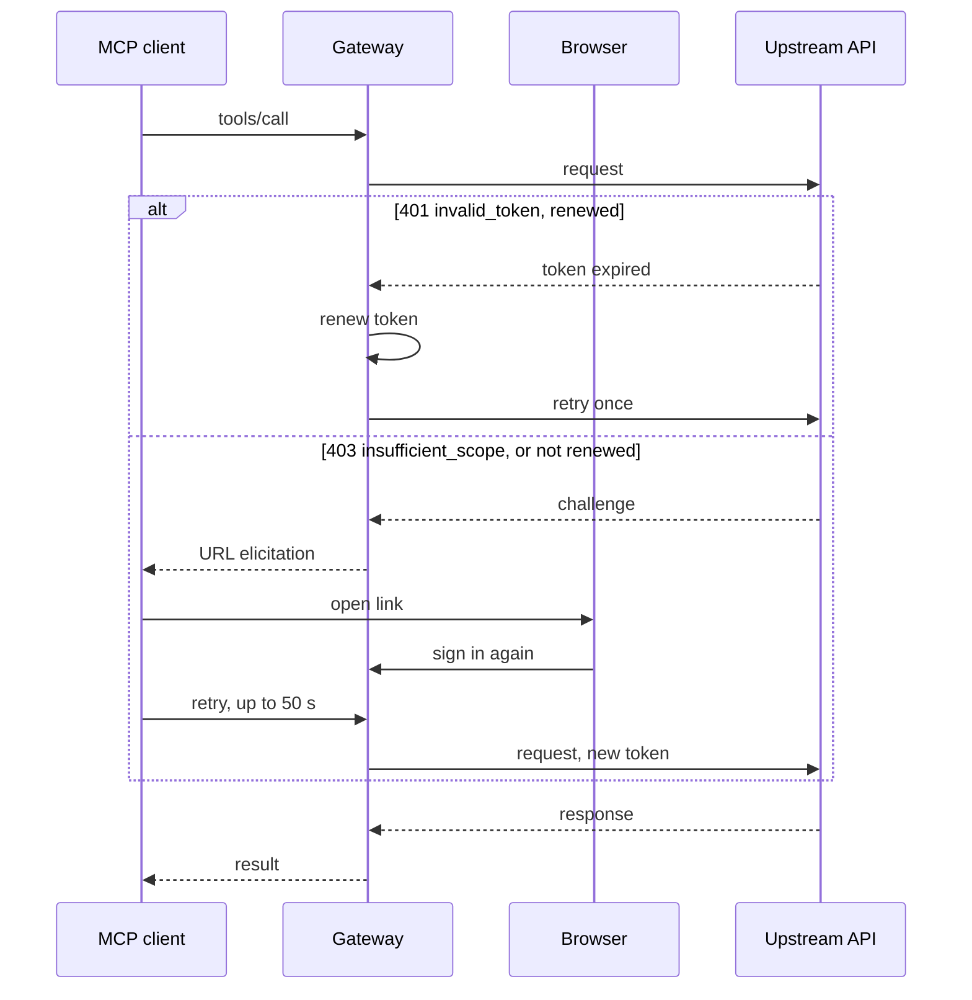

# Token Lifecycle

This page explains how long each mode's tokens last, which endpoint a token is good at, how tokens are revoked, and what the gateway does when the upstream refuses one.

## Token Lifetimes

Who sets a lifetime depends on who mints the token.

| Mode | MCP Token | Upstream Token |
| --- | --- | --- |
| `authorization_code` | minted by the gateway, `auth.mcp.access_token_ttl` and `auth.mcp.refresh_token_ttl` | the upstream's, renewed through the MCP refresh |
| Shared Credential With `auth.mcp.clients` | minted by the gateway, `auth.mcp.access_token_ttl` only | the shared credential |
| `token_exchange` | the issuer's | each exchange's, cached per caller |
| Shared Credential With `auth.mcp.issuer` | the issuer's | the shared credential |
| `oauth2` + `client_credentials` | none | one service token, renewed 30 seconds before it expires |

### Under `authorization_code`

Both MCP token lifetimes default to the values [Configuration](../reference/configuration.md#authmcp) lists. Each refresh issues a new refresh token, so a client that refreshes before its refresh token expires stays signed in while the upstream token can still be renewed.

- **Capped Access Token**: an MCP access token never outlives the upstream token behind it, so the client refreshes before its calls start failing.
- **Upstream Renewal**: an MCP refresh also renews the upstream token, once less than half an access token's lifetime remains of it.
- **Sign In Again**: once the upstream token has expired and cannot be renewed, the refresh fails with `invalid_grant` and the user signs in again. An upstream that issues refresh tokens only for `offline_access` needs it in `auth.upstream.required_scopes`, or users sign in again whenever the upstream token expires.

### Under Agents and External Issuers

Agents with `auth.mcp.clients` get no refresh token, so `refresh_token_ttl` is refused there. An agent requests a new access token when its old one expires. Under an external issuer the gateway mints nothing, so lifetimes are the issuer's to set. Under `token_exchange` each exchanged token is cached for the caller's token and the scopes asked for. It is renewed 30 seconds before it expires, but never before half its lifetime, and taken to last 1 hour when the issuer states no lifetime.

## Token Audience

A token is good only at the MCP endpoint it was obtained for, so a token for another server is refused, even one minted by another server of the same gateway.

- **Requested Resource**: where the gateway mints tokens, a sign-in or token request whose [RFC 8707](https://www.rfc-editor.org/rfc/rfc8707) `resource` names another endpoint is refused with `invalid_target`. A request naming no `resource` gets a token for this endpoint.
- **Minting Server**: every code and token the gateway mints is bound to the server that minted it. Another server of the same gateway, reading the same store, treats it as unknown, so one server's token never reaches another server's upstream credential.
- **Upstream Server**: under `authorization_code`, a token is also bound to the upstream authorization server, named by `auth.upstream.issuer` when set and by its token endpoint otherwise. Pointing the server at another one refuses the earlier tokens, so users sign in again and no refresh token reaches the new server.
- **External Issuer**: under `token_exchange` or `auth.mcp.issuer`, every token must name the endpoint in `aud`, in the normalized form [Token Exchange](../guides/authorization.md#token-exchange) gives.

## Revocation

The gateway can refuse tokens it minted, while a token from an external issuer stays valid until it expires.

- **Removed Client**: under `authorization_code` or agents, removing a client from `auth.mcp.clients`, or its host from `auth.mcp.other_clients.trusted_hosts`, refuses its tokens from the next request after the gateway restarts.
- **Rotated Secret**: rotating an agent's secret does not revoke its tokens. Its access token lasts until it expires.
- **Client Revocation**: under `authorization_code`, a client can revoke its own tokens at the gateway's revocation endpoint.
- **Upstream Revocation**: under `authorization_code`, revoking the user at the upstream authorization server ends the MCP session once the upstream token expires and its renewal is refused.
- **External Issuer**: the gateway verifies the issuer's tokens by signature, so a token the issuer revokes stays valid until it expires.

## Upstream Token Refusals

Under `authorization_code` the gateway reads the upstream's [RFC 6750](https://www.rfc-editor.org/rfc/rfc6750#section-3) challenge on a refused tool call and recovers where it can. In every other mode, and for upstreams that send no such challenge, the refusal reaches the client unchanged.

- **Expired Token**: on `401` with `error="invalid_token"`, the gateway renews the upstream token and sends the request once more, and the user sees nothing. A token that cannot be renewed gets the sign-in link described next.
- **Missing Scope**: on `403` with `error="insufficient_scope"`, the client shows the user a link to sign in to the upstream again, as a [URL-mode elicitation](https://modelcontextprotocol.io/specification/2026-07-28/client/elicitation#url-mode-elicitation-requests), an MCP request that the client open a link for the user. The new sign-in asks for what the first one did, what the upstream already granted, and what the challenge names. The call then continues with the same MCP token.
- **Ceiling**: when `auth.upstream.scopes` is set, or `enforce_scopes` derives it from the operations, the challenge's scopes must fall within it and `auth.upstream.required_scopes`, counting what `scope_implies` covers. A wider scope is not offered.
- **Same Browser**: only the browser the user first signed in with may finish the new sign-in.
- **Waiting**: calls refused together share one sign-in. The retry waits up to 50 seconds. A declined or unfinished sign-in ends the call with an error that says so, and sends nothing upstream. An unfinished one stays open for 15 minutes, so a call made after the user finishes goes through.
- **Not Offered**: a client without URL elicitation, a client on a protocol version before 2026-07-28, a resource read, and a scope beyond the ceiling all get the upstream error as it is.

## Related

The auth mode decides who mints each token, and the scope fields bound what a new sign-in asks for.

- **Guides**: [Authorization](../guides/authorization.md#mode-selection) for the mode behind each row of the lifetime table and [Scopes](../guides/scopes.md#asking-the-upstream-for-less) for the ceiling a new sign-in stays within
- **Reference**: [`auth.upstream`](../reference/configuration.md#authupstream) for `required_scopes`, `scopes` and `scope_implies`
