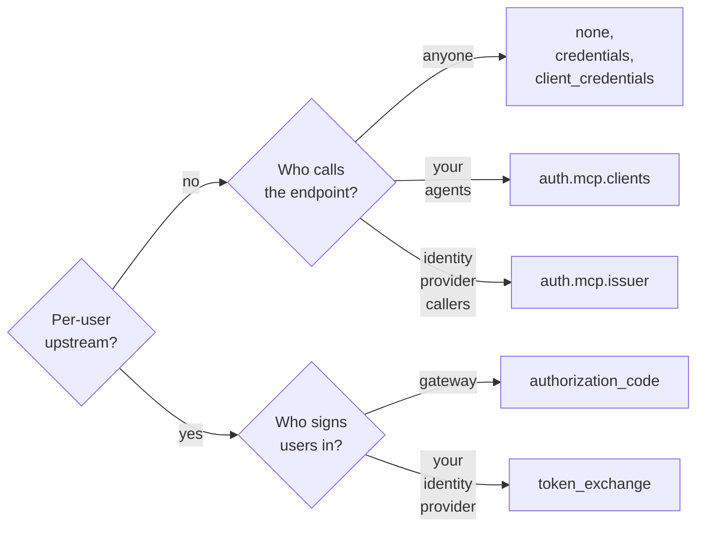

# Authorization

One `auth:` block decides who may call an MCP endpoint and what credential reaches the API behind it. This guide covers choosing a mode for your deployment and setting it up, from the simplest to the most delegated.

## Mode Selection

`auth.upstream` covers the API and `auth.mcp` the MCP endpoint. `auth.upstream.type`, plus `auth.upstream.flow` under `oauth2`, picks the credential. [Architecture](../concepts/architecture.md#two-authorization-boundaries) explains the two boundaries.

| Mode | MCP Endpoint | Credential Sent Upstream |
| --- | --- | --- |
| `none` | open | none |
| `credentials` | open | keys or tokens from config, shared by every caller |
| `oauth2` + `client_credentials` | open | one service token, shared by every caller |
| `passthrough` | open | the caller's own header, forwarded unchanged |
| `oauth2` + `authorization_code` | the gateway is the authorization server | a per-user token the gateway obtained on their behalf |
| `oauth2` + `token_exchange` | an external issuer is the authorization server | a per-user token exchanged from the caller's |
| Shared Credential With `auth.mcp.clients` | the gateway issues tokens to each agent | the shared credential, while each agent reaches only what its scopes open |
| Shared Credential With `auth.mcp.issuer` | an external issuer is the authorization server | the shared credential, while each caller reaches only what the issuer granted |

An authorization server is the service that signs users in and issues tokens. An issuer is an authorization server named by its URL, and an external issuer is one your deployment already runs, such as an identity provider. A shared credential is `none`, `credentials` or `oauth2` + `client_credentials`. `passthrough` exists for the [FastAPI integration](python.md#fastapi-integration) only.

Under `authorization_code`, MCP scopes are granted per client rather than per person, as [Granting Scopes to Clients](scopes.md#granting-scopes-to-clients) explains.

Two questions decide the mode.



> [!WARNING]
> The open modes check nothing on the MCP endpoint, so anyone who can reach the port calls the API with the shared credential. Run them on localhost or inside a private network, or add `auth.mcp.clients` or `auth.mcp.issuer`.

## Shared Credentials

A shared credential sends the same upstream identity on every call, whoever the caller is. Set its environment variable and reference it with `${VAR}`, so no secret is stored in the file.

`auth.upstream.credentials` gives a value for each security scheme the spec declares, keyed by the scheme's name. Where each value travels comes from the scheme. An `apiKey` scheme names its header, query parameter or cookie, and an HTTP `bearer` scheme travels as `Authorization: Bearer`.

=== "API Key"

    The National Weather Service spec declares a `User-Agent` header as its `userAgent` scheme:

    ```yaml
    servers:
      - name: weather
        spec: https://api.weather.gov/openapi.json
        auth:
          upstream:
            credentials:
              userAgent:
                value: ${WEATHER_USER_AGENT}
    ```

=== "Spec Without a Scheme"

    GitHub's spec declares no security scheme, so the server declares the one GitHub takes and makes it the root `security`:

    ```yaml
    servers:
      - name: github
        spec: https://raw.githubusercontent.com/github/rest-api-description/main/descriptions/api.github.com/api.github.com.json
        security_schemes:
          token:
            type: http
            scheme: bearer
        security:
          - token: []
        auth:
          upstream:
            credentials:
              token:
                value: ${GITHUB_TOKEN}
    ```

=== "Client Credentials"

    ```yaml
    servers:
      - name: internal
        spec: https://internal.example.com/openapi.json
        auth:
          upstream:
            type: oauth2
            flow: client_credentials
            client_id: ${GATEWAY_CLIENT_ID}
            client_secret: ${GATEWAY_CLIENT_SECRET}
            token_url: https://auth.example.com/oauth/token
            scopes: [read]
    ```

Under `client_credentials` the gateway fetches one service token on the first call and renews it shortly before it expires. `token_url` and `scopes` come from the spec's `securitySchemes` when it declares a `clientCredentials` flow. Set them only when the spec declares no OAuth flow at all, since a spec whose OAuth flows leave out `clientCredentials` makes `flow: client_credentials` fail at startup.

### Which Credential Each Operation Carries

An operation's `security` lists alternatives, and each names the schemes it needs together. At startup, each exposed operation settles on the first alternative in spec order that the config meets, and every call to it carries that alternative's credentials. An empty alternative, `{}`, makes the credential optional, so it is chosen only when the config meets no other alternative. `operations.<id>.security` picks another alternative for one operation.

- **Overrides**: `security_schemes` merges into the spec's schemes, replacing one of the same name, and `security` replaces the spec's root `security`. An operation that declares its own `security` keeps it.
- **Startup Check**: an exposed operation that no alternative is met for refuses startup, and so does a credential that no exposed operation uses. `policy.deny` leaves an operation out of both checks.
- **Beside a Flow**: `credentials` combines with `type: oauth2` and one `flow`, so an operation served by a key carries the key and one served by OAuth carries the token. An operation the keys serve alone never fetches the token, and a refusal of its key starts no renewal or sign-in. Upstream scopes count only the OAuth part of the alternative each operation settled on. `type: passthrough` refuses `credentials`.
- **Redaction**: a credential sent in the query string is replaced by `[REDACTED]` in the gateway's logs and in the errors it returns to the client.

## Per-User Sign-In

`authorization_code` makes the gateway the authorization server for the MCP endpoint. Each user signs in to the upstream through it, and the gateway holds their upstream token. Register an OAuth app with the upstream and give it the callback `{url}{mount_path}/auth/callback`, such as `http://localhost:8000/asana/auth/callback`.

=== "Asana"

    ```yaml
    url: http://localhost:8000
    servers:
      - name: asana
        spec: https://raw.githubusercontent.com/Asana/openapi/master/defs/asana_oas.yaml
        auth:
          upstream:
            type: oauth2
            flow: authorization_code
            client_id: ${ASANA_CLIENT_ID}
            client_secret: ${ASANA_CLIENT_SECRET}
            scopes: [users:read, workspaces:read]
            required_scopes: [openid, email, profile]
    ```

=== "GitHub"

    ```yaml
    url: http://localhost:8000
    servers:
      - name: github
        spec: https://raw.githubusercontent.com/github/rest-api-description/main/descriptions/api.github.com/api.github.com.json
        auth:
          upstream:
            type: oauth2
            flow: authorization_code
            # GitHub's spec declares no securitySchemes,
            # so both URLs are set here.
            authorization_url: https://github.com/login/oauth/authorize
            token_url: https://github.com/login/oauth/access_token
            client_id: ${GITHUB_CLIENT_ID}
            client_secret: ${GITHUB_CLIENT_SECRET}
            scopes: [repo, read:org]
    ```

`authorization_url` and `token_url` come from the spec when it declares them. GitHub's operations declare no `security`, so leave `enforce_scopes` off there, as [Edge Cases](../concepts/scope-model.md#edge-cases) explains. `required_scopes` is asked for at every sign-in. Put `offline_access` there when the upstream issues refresh tokens only for it, as [Token Lifecycle](../concepts/token-lifecycle.md#under-authorization_code) explains. Set `issuer` to the upstream's issuer identifier to turn on the [RFC 9207](https://www.rfc-editor.org/rfc/rfc9207) mix-up check, which refuses a sign-in response sent by an authorization server other than the one the user was sent to. A response that carries `iss` must then name that issuer, and a response without `iss` is accepted.

During each MCP sign-in, before the upstream sign-in, the gateway shows its own consent page naming the client, where access is sent, and what it may do. [Consent Page](scopes.md#consent-page) covers what it shows and when it is skipped. [Token Lifecycle](../concepts/token-lifecycle.md) covers how long the tokens last, and [Token Audience](../concepts/token-lifecycle.md#token-audience) why a token works only at the endpoint it was minted for.

### Client Registration

An MCP client needs a `client_id` the gateway accepts before it can sign in. The [MCP spec](https://modelcontextprotocol.io/specification/2026-07-28/basic/authorization/client-registration) defines three ways to get one, in order of preference.

| Method | How the Client Gets Its ID | Gateway Setting |
|---|---|---|
| Pre-Registration | You give it a `client_id` ahead of time | a name under `auth.mcp.clients` |
| Client ID Metadata Document (CIMD) | It uses an `https` URL as its `client_id`, and the gateway fetches the JSON document there | a URL under `auth.mcp.clients`, or `auth.mcp.other_clients` |
| Dynamic Client Registration (DCR) | It registers itself at `{url}{mount_path}/register` | only when neither key is set, since the spec deprecates it |

Claude Code, for example, is a metadata document client. A config can list known clients and admit others by host:

```yaml
auth:
  mcp:
    clients:
      https://claude.ai/oauth/claude-code-client-metadata: {}
      internal-cli:
        redirect_uris: [https://cli.example.com/callback]
    other_clients:
      trusted_hosts: [vscode.dev]
```

- **Listed by URL**: a metadata document client. It takes no `client_secret` or `redirect_uris`, since its document lists them.
- **Listed by Name**: a pre-registered client. Without `client_secret` it is public and held to PKCE, a one-time proof that the client finishing a sign-in is the one that started it. Without `redirect_uris` it may redirect to any loopback address, on any port.
- **Other Clients**: admits metadata document clients that `clients` does not list, only from `trusted_hosts` when set, which match hosts exactly. `false` admits none, and so does leaving it unset while `clients` is set.
- **Default**: with neither key set, any metadata document client may sign in, and so may a client using DCR. Setting either key turns DCR off, because nothing a client registers can be checked against `trusted_hosts`.
- **Document Fetching**: the gateway fetches a metadata document over `https` from a public address only, within 5 seconds, and refuses one over 5 KB. It caches each document for what its `Cache-Control` says, between 5 minutes and 24 hours.

Under `token_exchange` or `auth.mcp.issuer`, clients register at your identity provider instead, as [Identity Providers](identity-providers.md#client-registration) describes.

## Separate Identity Provider

Some APIs have no authorization server of their own and accept tokens from an identity provider the deployment already runs. Point the OAuth URLs at that identity provider and name the API the token is for, its audience, which the token carries in its `aud` claim:

```yaml
servers:
  - name: internal
    spec: https://internal.example.com/openapi.json
    auth:
      upstream:
        type: oauth2
        flow: authorization_code
        authorization_url: https://you.auth0.com/authorize
        token_url: https://you.auth0.com/oauth/token
        client_id: ${GATEWAY_CLIENT_ID}
        client_secret: ${GATEWAY_CLIENT_SECRET}
        audience: https://internal.example.com
```

Without it the identity provider mints a token for its own default audience, which the API refuses. The parameter goes on the authorization request and on every token request, refreshes included. Authorization servers disagree on its name.

| Key | Parameter | Read By |
| --- | --- | --- |
| `auth.upstream.resource` | `resource`, from [RFC 8707](https://www.rfc-editor.org/rfc/rfc8707) | servers following the RFC |
| `auth.upstream.audience` | `audience` | Auth0 and others |

Set the one your authorization server reads, or both. A server ignores a parameter it does not recognize, so a server given only the other one returns a token whose audience is wrong, and the upstream then refuses it for reasons that look unrelated. Sending both is legal under RFC 8707 and is the portable choice. Keycloak reads neither and needs an audience mapper, as [Client Scopes](identity-providers.md#client-scopes) shows.

MCP clients still sign in to the gateway and receive a gateway-issued token. The identity provider's token is a second credential the gateway holds on their behalf. [`examples/auth0-management.yml`](https://github.com/mroops0111/openapi-mcp-gateway/blob/master/examples/auth0-management.yml) is a worked example.

## Token Exchange

`token_exchange` removes the gateway as an issuer. Your identity provider mints tokens for the MCP endpoint directly, the gateway verifies them, and each call exchanges the caller's token under [RFC 8693](https://www.rfc-editor.org/rfc/rfc8693) for one naming the upstream. Revoking a user at the identity provider then reaches the gateway as soon as their tokens expire.

```yaml
servers:
  - name: internal
    spec: https://internal.example.com/openapi.json
    auth:
      upstream:
        type: oauth2
        flow: token_exchange
        audience: https://internal.example.com
        client_id: ${GATEWAY_CLIENT_ID}
        client_secret: ${GATEWAY_CLIENT_SECRET}
      mcp:
        issuer: https://auth.example.com/realms/internal
        required_scopes: [mcp]
```

- **Extra**: verifying JWT signatures needs the `oidc` extra, so run `uvx --from 'openapi-mcp-gateway[oidc]' openapi-mcp-gateway`. Without it the gateway refuses to start and says so.
- **Required Keys**: `auth.mcp.issuer`, `auth.mcp.required_scopes`, `client_id`, `client_secret`, and `audience` or `resource`.
- **Discovery**: the gateway serves no `{url}{mount_path}/authorize` or `{url}{mount_path}/token`. Its protected resource metadata, the discovery document that tells a client where to get a token, names the issuer, and lists `required_scopes` as the scopes every client asks for first. Signing keys come from the issuer's metadata, so key rotation needs no restart.
- **Audience**: the endpoint is `{url}{mount_path}/mcp`, such as `https://gw.example.com/internal/mcp`. Every inbound token's `aud` must hold it in normalized form, with a lowercase host, no default port and no trailing slash.

Your issuer must support token exchange and accept the endpoint as an audience. [Identity Providers](identity-providers.md) covers which ones do and how to set up Keycloak. To scope operations by what the issuer grants, see [Scopes Under an External Issuer](scopes.md#scopes-under-an-external-issuer).

## Agents on a Shared Credential

A shared credential sees every agent as one identity. Declare each agent under `auth.mcp.clients` with a secret, and the gateway issues it an MCP token through `client_credentials`:

```yaml
servers:
  - name: github
    spec: https://raw.githubusercontent.com/github/rest-api-description/main/descriptions/api.github.com/api.github.com.json
    security_schemes:
      token: {type: http, scheme: bearer}
    security:
      - token: []
    auth:
      upstream:
        credentials:
          token: {value: "${GITHUB_TOKEN}"}
      mcp:
        operation_scopes:
          # issues:read comes from the spec's issues tag.
          auto: tags
        clients:
          reader:
            client_secret: ${READER_SECRET}
            scopes: [issues:read]
```

Each agent posts its `client_id` and `client_secret` to `{url}{mount_path}/token`, as the MCP SDK's `ClientCredentialsOAuthProvider` does. Every call still reaches the API with the shared credential.

Where your identity provider already knows these callers, set `auth.mcp.issuer` and `auth.mcp.required_scopes` in place of `clients`, as under `token_exchange`. Only one of the two may issue an endpoint's tokens, so setting both is refused. [Scopes](scopes.md) covers what each agent may reach.

## Related

The architecture page explains the two boundaries an `auth` block configures, and the reference lists the fields of the MCP side.

- **Concepts**: [Architecture](../concepts/architecture.md#two-authorization-boundaries) for what each half of `auth` guards and [Security](../concepts/security.md) for the access layers and safeguards each mode relies on
- **Reference**: [`auth.mcp`](../reference/configuration.md#authmcp) for every field that decides who may call the endpoint
