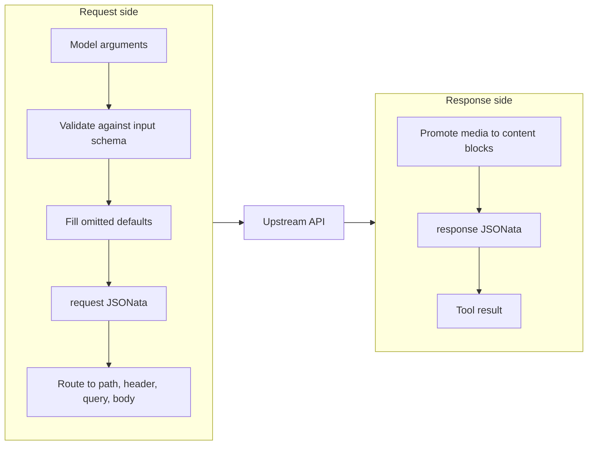

# Tool Shaping

A raw operation rarely makes a good tool. This guide covers changing what a tool is called, what it takes and what it returns, in YAML and without forking the spec. [Context Efficiency](../concepts/context-efficiency.md) explains how shaping keeps schemas and results small beside the other levers.

## Problems and Fields

Each common problem has a field that fixes it.

| Problem | Field |
|---|---|
| An unclear `operationId`, such as GitHub's `actions/list-jobs-for-workflow-run-attempt` | `name` |
| An empty or unhelpful description | `description` |
| A wrong hint, such as a search `POST` that only reads | `annotations` |
| Parameters the model should never set | `params` with `hidden` |
| A cryptic filter syntax the model gets wrong | `params_strategy: replace` with `request` |
| A large envelope around a few useful fields | `response` |
| A file embedded as base64 text | `media` |

## Config and Spec Forms

Shaping goes in a `tool` block, written in one of two places. The config's `operations` map, keyed by `operationId`, suits a spec you do not control. The spec's own `x-mcp-integration` extension on the operation suits a spec you own. Both take the same keys. A config entry replaces the spec's `x-mcp-integration` for that operation rather than merging with it.

=== "In config"

    ```yaml
    servers:
      - name: github
        spec: https://raw.githubusercontent.com/github/rest-api-description/main/descriptions/api.github.com/api.github.com.json
        operations:
          pulls/list-files:
            tool:
              name: list_pull_request_files
              description: |
                List files changed in a pull request. Returns up to 3000 files,
                each with status (added / modified / removed), patch text, and
                line counts.
    ```

=== "In the spec"

    ```yaml
    paths:
      /repos/{owner}/{repo}/pulls/{pull_number}/files:
        get:
          operationId: pulls/list-files
          x-mcp-integration:
            tool:
              name: list_pull_request_files
              description: List files changed in a pull request.
    ```

The examples below show only the `operations` form.

## Shaping Pipeline

Each call passes through the shaping steps in order:



An argument that breaks the schema, such as a value outside an `enum`, is refused before any request is sent. Without a `request` expression, the arguments route straight from step C.

## Annotations

Every tool carries MCP annotations derived from its HTTP method. `GET` is read-only and idempotent. `PUT`, `PATCH` and `DELETE` are idempotent, and `DELETE` is destructive. `annotations` overrides single hints and keeps the rest:

```yaml
operations:
  # A POST that only reads.
  searchIssues:
    tool:
      annotations:
        readOnlyHint: true
```

Keys may be camelCase or snake_case.

## Model-Facing Parameters

`params` changes what the model sees. Each entry is a JSON Schema fragment (`type`, `enum`, `default`, `description`, `format`, `minimum`, `items` and so on) plus two flags. `required` lifts the parameter into the schema's required list, and `hidden` removes it from the schema. `params_strategy` is mandatory whenever `params` is set:

| Strategy | Declared Entries | Spec Parameters | Needs `request` |
|---|---|---|---|
| `merge` | Tweak existing spec parameters. Naming one the spec lacks is an error. | Kept unless hidden | No |
| `replace` | Form the whole schema | Dropped, except a header an entry names, which stays a header | Yes |

```yaml
operations:
  searchIssues:
    tool:
      params_strategy: merge
      params:
        internal_flag: { hidden: true }
        per_page: { default: 30 }
        sort: { description: "One of comments, created, updated." }
```

### Defaults and Hidden Parameters

A `default` in `params` is sent upstream whenever the model omits the parameter, unlike a plain JSON Schema default, which is only advice. In the example above, a call without `per_page` sends `per_page=30`.

`hidden` behaves according to whether the entry has a default.

- **Hidden With a Default**: the model never sees the parameter, and every call sends the default, which pins the value.
- **Hidden Without a Default**: the parameter is dropped and never sent. A hidden path parameter needs a default or a `request` to fill it, or startup fails.

## Request and Response Transforms

`request` and `response` are [JSONata](https://jsonata.org/) expressions, both optional and independent. `request` builds the whole upstream request from the arguments, defaults included. `response` reshapes a successful body before it reaches the client.

```yaml
operations:
  searchIssues:
    tool:
      request: |
        $merge([$, { "per_page": 30, "state": "open" }])
      response: |
        [items.{ "title": title, "url": html_url }]
```

These rules decide where each value goes and what happens when an expression fails.

- **Routing**: a key naming a path placeholder fills the path, and a key naming a header parameter becomes that header. The rest become query parameters for a body-less method, or the JSON body otherwise. A value goes out only if the result carries it.
- **Passthrough**: `$merge([$, { ... }])` forwards the incoming arguments and overrides only the keys you name.
- **Lists**: wrapping a mapping in `[ ... ]` keeps the result an array even when one item matches.
- **Errors**: a broken expression fails startup. A runtime failure returns an `isError` result naming the side that broke.

[`examples/github-shaping.yml`](https://github.com/mroops0111/openapi-mcp-gateway/blob/master/examples/github-shaping.yml) is a full `replace` example, where `request` builds GitHub's search query from a repository, a state and a label.

## Promoting Base64 Fields With `media`

A base64 field can move into its own image, audio or blob content block, leaving a placeholder such as `<content[1]: image/png>` in the JSON. The gateway finds such fields two ways.

- **From the Spec**: a response field marked with OpenAPI 3.1 `contentEncoding: base64` is promoted with no config, typed by its `contentMediaType`.
- **From `media`**: any other field, named by its path in the upstream response.

```yaml
operations:
  getContract:
    tool:
      media:
        attachments[*].content:
          encoding: base64
          media_type: application/pdf
```

[Operation Fields](../reference/configuration.md#operation-fields) gives the default `media_type`. A `media` entry overrides the spec for the same path. A binary response body, such as an image, becomes a content block with no config at all.

## Related

The architecture page covers what every tool gets before any shaping, and the reference lists every key of a `tool` block.

- **Concepts**: [Architecture](../concepts/architecture.md#tool-results) for the titles, annotations and structured results every tool gets
- **Reference**: [Operation Fields](../reference/configuration.md#operation-fields) for every `tool` key with its type and default
